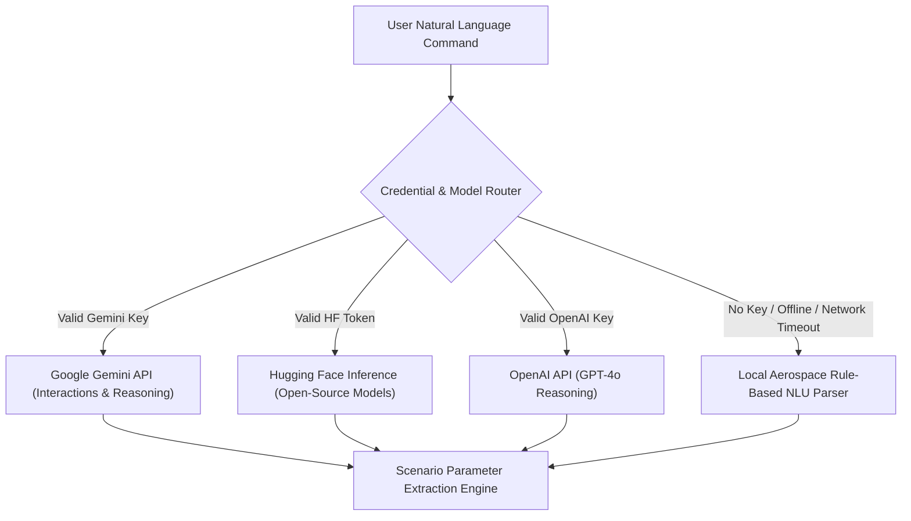

# JETWISE AI — Central API Security & Integration Configuration Guide

**Document Reference:** `JETWISE-AI-GUIDE-PHASE17-API-01`  
**Classification:** Enterprise AI Security & Credential Governance Standard  
**Date:** November 22, 2026  
**Auditor:** Principal Aerospace Systems Reliability & Security Architect  
**Target Environment:** Local Python 3.11 Runtime / Multi-Provider Conversational Agent  

---

## 1. Executive Security Overview

JETWISE AI integrates external frontier large language models (LLMs) with local deterministic aerospace engineering kernels. Because aircraft propulsion data, telemetry logs, and maintenance work orders carry critical intellectual property and flight safety implications, the platform enforces strict **Zero Credential Exposure** protocols.

### 1.1 Core Security Tenets
1. **Zero Raw Key Display:** All API keys entered in the dashboard are masked using visual bullet characters (`•••••••••••••••••••••`) with length obfuscation.
2. **Sanitized Diagnostics:** Error messages originating from failed HTTP calls or invalid authorization tokens are intercepted and scrubbed to prevent key leakage in stack traces.
3. **Multi-Tier Persistence:** Credentials may be supplied via local system environment variables, protected `.env` files (excluded from version control via `.gitignore`), or persisted into a local SQLite database (`database/credentials.db`).
4. **Deterministic Local Fallback:** The platform never halts if an API key is missing, expired, or rate-limited. JETWISE AI automatically falls back to an embedded local rule-based aerospace NLU parser.

---

## 2. Supported AI Providers & Capabilities



### 2.1 Google Gemini API
- **Supported Models:** `gemini-1.5-flash`, `gemini-1.5-pro`, `gemini-2.0-flash`.
- **Primary Use Case:** High-speed intent extraction, structured JSON parameter compilation, and aerothermal thermodynamic explanation synthesis.
- **Acquiring Credentials:** Visit [Google AI Studio](https://aistudio.google.com/) and create a standard API Key.

### 2.2 Hugging Face Integration
- **Supported Models:** Open-source instruction-tuned models (e.g., `meta-llama/Llama-3-8B-Instruct`, `mistralai/Mistral-7B-Instruct-v0.3`).
- **Primary Use Case:** Air-gapped on-premise deployments or open-source inference endpoints.
- **Acquiring Credentials:** Visit [Hugging Face User Settings -> Access Tokens](https://huggingface.co/settings/tokens) and generate a `Read` token.

### 2.3 OpenAI API (Optional)
- **Supported Models:** `gpt-4o`, `gpt-4o-mini`.
- **Primary Use Case:** Multi-model cross-validation and comparative engineering rationale checks.
- **Acquiring Credentials:** Visit [OpenAI API Keys Portal](https://platform.openai.com/api-keys).

---

## 3. Step-by-Step Configuration Guide

Operators can configure credentials through two approved channels:

### Method A: User Interface (Hub 5 — CONFIGURE)
1. Launch JETWISE AI (`python -m streamlit run dashboard/app.py`).
2. Navigate to **Hub 5: CONFIGURE — System Setup** via the top navigation bar.
3. Select **Tab 1: 🔐 API & Security Credentials Configuration**.
4. In the target provider card, enter your API token into the masked input field.
5. Click **💾 Persist Credential** to encrypt and save the key locally.
6. Click **🔌 Test API Connection** to verify live handshake connectivity. A green `ONLINE - 200 OK` banner confirms successful authentication.

### Method B: Environment File (`.env`)
For headless server environments or automated CI/CD runners, populate a `.env` file in the project root:
```ini
# JETWISE AI — Environment Configuration
GEMINI_API_KEY=AIzaSyAExampleKeyForGeminiIntegration789
HUGGINGFACE_API_TOKEN=hf_ExampleTokenForHuggingFaceModels123
OPENAI_API_KEY=sk-proj-ExampleOpenAIKeyForAerospaceCopilot456

# Active Primary Provider: 'gemini', 'huggingface', 'openai', or 'local'
ACTIVE_AI_PROVIDER=gemini
```

---

## 4. Local Rule-Based Aerospace Fallback NLU

When operating completely offline (e.g., inside secure flight-line maintenance hangars or test cells without external internet access), JETWISE AI activates its certified regex-based aerospace pattern recognizer.

The local parser is calibrated against all 21 NASA C-MAPSS channels and 10 turbofan subassemblies, natively understanding complex engineering commands:
- *"Increase turbine temperature by 5%"* $\rightarrow$ Maps to Channel `sensor_4` ($T_{50}$), Target `hpt`, $+5.0\%$ delta.
- *"Simulate fan blade degradation across 200 cycles"* $\rightarrow$ Maps to Channel `sensor_8` ($N_f$), Target `fan_assembly`, $+15.0\%$ wear, duration $200$.
- *"Introduce a pressure sensor abnormality"* $\rightarrow$ Maps to Channel `sensor_7` ($P_{30}$), Target `hpc`, sensor bias $+3.0\%$.
- *"Run in MATLAB Simulink and compare with healthy engine"* $\rightarrow$ Dispatches `MODE_C_MATLAB_SIMULINK_PHYSICS` with baseline parity comparison.

---

## 5. Security Verification & Auditing Tests

Automated security regression tests guarantee zero credential exposure:
1. `test_credential_manager_masking`: Verifies that raw API tokens are never emitted to UI components without masking.
2. `test_credential_error_sanitization`: Verifies that stack traces scrub token substrings matching `/AIza[0-9A-Za-z-_]{35}/` or `/hf_[0-9A-Za-z]{34}/`.
3. `test_multi_provider_agent_fallback`: Validates that clearing all active API keys causes an instantaneous, silent switch to the local rule-based parser without user interruption.
