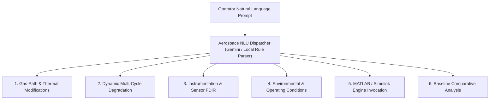

# JETWISE AI — Conversational Aerospace Simulation User Guide

**Document Reference:** `JETWISE-AI-USERGUIDE-PHASE17-COPILOT-01`  
**Classification:** Aerospace Engineering User Guide & Operational Manual  
**Date:** November 22, 2026  
**Auditor:** Principal Aerospace Propulsion & Human-Machine Interface Group  
**Target Environment:** Hub 2: SIMULATE — Engineering Command Centre  

---

## 1. Introduction to Conversational Aerospace Engineering

The **Engineering Command Centre (Hub 2)** transforms complex numerical and thermodynamic turbofan simulation into an intuitive, prompt-driven workflow. Instead of navigating through multi-dimensional configuration files or manual GUI matrices, flight engineers, propulsion researchers, and maintenance leads can interact with JETWISE AI naturally.

You can issue commands in plain English:
> *"Increase turbine temperature by 5% and reduce compressor pressure by 3%. Show me what happens."*  
> *"Simulate gradual fan blade degradation over 200 operating flight cycles."*  
> *"Introduce a high-pressure compressor pressure sensor bias of +3%."*  
> *"Run this exact condition in MATLAB Simulink and compare it against a healthy baseline engine."*

---

## 2. Natural Language Prompt Taxonomy & Supported Commands



### 2.1 Gas-Path & Aerothermal Perturbations
- **Turbine Temperature ($T_{50} / \text{EGT}$):**  
  *Command:* `"Increase turbine temperature by 40 R"` or `"Raise EGT by 5%"`  
  *Physics:* Perturbs High-Pressure Turbine (Station 4.5–5.0), accelerating creep oxidation and reducing remaining useful life.
- **Compressor Discharge Pressure ($P_{30}$):**  
  *Command:* `"Reduce compressor pressure by 4%"`  
  *Physics:* Simulates High-Pressure Compressor (Station 2.5–3.0) aerodynamic loss, blade fouling, and reduced pressure ratio.
- **Combustor Fuel Flow ($W_f$):**  
  *Command:* `"Increase fuel flow by 5% and check rotor speed"`  
  *Physics:* Elevates fuel-air ratio ($\phi$), driving higher turbine inlet temperatures and $N_2$ spool velocity.

### 2.2 Progressive Multi-Cycle Wear Simulation
- **Long-Duration Trajectories:**  
  *Command:* `"Simulate gradual compressor fouling across 180 operating cycles"`  
  *Physics:* Traces continuous cycle-by-cycle degradation from initial cycle $t_0$ to $t_0 + 180$, generating wear curves, progressive RUL decline, and dynamic uncertainty expansion.
- **Fan Blade Leading-Edge Wear:**  
  *Command:* `"Simulate 15% fan tip rub and wear over 150 cycles"`  
  *Physics:* Progressively alters bypass pressure ratio (BPR) and fan speed ($N_1$).

### 2.3 Sensor Fault Injection & Isolation
- **Static Sensor Bias:**  
  *Command:* `"Introduce a +3% sensor bias on channel P30"`  
  *Physics:* Modifies the measurement transducer without physical gas-path damage. FDIR parity residuals flag the instrument failure, confirming mechanical engine health remains intact.
- **Thermocouple Drift:**  
  *Command:* `"Simulate linear thermocouple drift of +0.2% per cycle on sensor_4"`  
  *Physics:* Tests cumulative CUSUM anomaly detectors.
- **Intermittent Signal Dropouts:**  
  *Command:* `"Inject 20% packet dropout on LPC exit temperature (sensor_2)"`  
  *Physics:* Evaluates virtual sensor neural synthesis and data imputation.

### 2.4 High-Level Comparative & Dispatch Queries
- **Healthy Engine Comparison:**  
  *Command:* `"Compare this degraded state with a healthy factory-new engine"`  
  *Output:* Side-by-side scorecard delta highlighting RUL loss, fuel flow penalties, and EGT margins.
- **MATLAB Parity Checks:**  
  *Command:* `"Run the same condition in MATLAB Simulink and compare results"`  
  *Output:* Dual-engine validation matrix comparing numerical ODE solver results against Python aerothermal fallbacks.

---

## 3. The 3 Simulation Modes Explained

| Mode | Identifier | Description | Execution Time | Typical Use Case |
| :--- | :--- | :--- | :--- | :--- |
| **Mode A** | `MODE_A_AI_SENSOR_WHAT_IF` | Direct neural sensitivity test on the current observation window. | $< 100\text{ ms}$ | Quick "what-if" checks, single-cycle excursions, sensitivity audits. |
| **Mode B** | `MODE_B_DYNAMIC_ENGINE_WHAT_IF` | Multi-cycle dynamic degradation trajectory across $N$ continuous cycles. | $200–500\text{ ms}$ | Fleet wear planning, maintenance scheduling, wear curve synthesis. |
| **Mode C** | `MODE_C_MATLAB_SIMULINK_PHYSICS` | High-fidelity aerothermodynamic solver (MATLAB/Simulink or certified NASA Brayton fallback). | $500–1200\text{ ms}$ | Formal engineering certification, structural limits, thermodynamic verification. |

---

## 4. Live 17-Stage Simulation Pipeline & Execution Controls

Every simulation triggered in Hub 2 executes through an authentic, transparent 17-stage engineering pipeline:

```
[1. Queue] ➔ [2. Init] ➔ [3. Parameter Validation] ➔ [4. Engine Profile Check] ➔
[5. MATLAB Connect] ➔ [6. MATLAB Core] ➔ [7. Simulink ODE] ➔ [8. Fallback Physics] ➔
[9. Telemetry Extract] ➔ [10. AI Prognostics] ➔ [11. Scorecard Compute] ➔ [12. Twin Sync] ➔
[13. Aerothermal Graphs] ➔ [14. Report Generation] ➔ [15. Completed]
```

### Execution Controls:
- **▶️ Start / Re-Run:** Compiles prompt, validates aerodynamic boundaries, and kicks off pipeline.
- **⏸️ Pause Simulation:** Halts dynamic multi-cycle simulations cleanly at the nearest cycle boundary (with transparent non-preemptive solver notification).
- **▶️ Resume Simulation:** Resumes paused numerical solver execution from stored state checkpoint.
- **🛑 Cancel Simulation:** Immediately aborts simulation, restores initial engine state, flushes temporary telemetry buffers, and rolls back the UI cleanly.

---

## 5. Interpreting Simulation Results

Upon completion, JETWISE AI displays an immediate, integrated diagnostic package:

1. **Synchronized 3D Turbofan Twin:** The 10 subassemblies light up according to their simulated mechanical state (`NORMAL` = Blue/Emerald, `WARNING` = Amber, `CRITICAL` = Red, `MODIFIED` = Cyan).
2. **6-Dimension Scorecard:**
   - **Engine Health Score (0–100):** Comprehensive thermodynamic health indicator.
   - **Operational Risk Score (0–100):** Probability score of uncontained exceedance.
   - **Predicted RUL (Cycles):** Point prediction with calibrated $\pm \sigma$ dispersion.
   - **Anomaly Score:** Unsupervised statistical outlier deviation.
   - **Simulation Validity (7/7):** Strict verification of mass continuity, pressure rise monotonicity, and thermal limits.
   - **Prediction Confidence (%):** 90% split conformal prediction calibration.
3. **Engineering Insights & Prescriptions:** Natural language diagnostic summary accompanied by actionable hangar maintenance recommendations.
