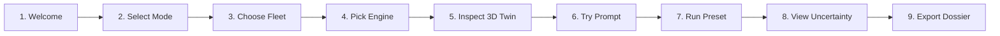

# JETWISE AI — Navigation & Onboarding Guide

**Document Reference:** `JETWISE-AI-GUIDE-PHASE17-ONBOARDING-01`  
**Classification:** Operator Onboarding & User Manual  
**Date:** November 22, 2026  
**Auditor:** Principal Aerospace UI/UX Architect & Training Group  
**Target Environment:** Hub 1: HOME — Mission Control  

---

## 1. Welcome to JETWISE AI

**JETWISE AI** is an advanced AI-powered aircraft engine health monitoring, 3D digital twin, and predictive maintenance intelligence platform. Whether you are an aerospace engineering student, an airline fleet maintenance manager, or a propulsion research scientist, JETWISE AI provides an intuitive yet mathematically rigorous interface to inspect, simulate, and forecast engine life.

---

## 2. Getting Started: The 9-Step Onboarding Wizard

Upon launching the application, **Hub 1 (HOME — Mission Control)** welcomes you with an interactive 9-step guided setup wizard. Each step guides you through a foundational capability of the platform:

### Step 1: Welcome & Mission Overview
- **Objective:** Understand the role of JETWISE AI in modern aviation safety and predictive maintenance.
- **Action:** Read the executive mission statement and observe the live System Readiness health bar.

### Step 2: Presentation Mode Selection
- **Objective:** Choose your preferred level of interface detail.
- **Action:** Toggle between **Simple Mode** (plain-language terms, clear health badges) and **Advanced Engineering Mode** (thermodynamic station nomenclature, ODE solver parameters, mathematical loss functions).

### Step 3: Fleet Dataset Selection
- **Objective:** Select your operating benchmark dataset.
- **Action:** Choose among NASA C-MAPSS subsets (`FD001`: Single fault / sea-level; `FD002`: Multi-condition; `FD003`: Multi-fault; `FD004`: Complex combined; `N-CMAPSS`: Transient flight envelopes).

### Step 4: Monitored Engine Unit Selection
- **Objective:** Focus diagnostic attention on a specific aircraft in the fleet.
- **Action:** Use the scrubber to select an individual engine ID (e.g. Unit #1, Unit #5, Unit #12) and inspect its logged flight cycles.

### Step 5: Inspect the 3D Turbofan Digital Twin
- **Objective:** Familiarize yourself with the 10 internal turbofan subassemblies.
- **Action:** Navigate to **Hub 3 (MONITOR)**. Rotate the 3D WebGL model, engage the exploded view slider to separate internal discs, and inspect station temperatures.

### Step 6: Execute a Natural Language Prompt
- **Objective:** Experience conversational simulation.
- **Action:** Navigate to **Hub 2 (SIMULATE)**. In the command box, type *"Increase turbine temperature by 5%"* and observe real-time parameter parsing.

### Step 7: Explore the 14 Standardized Presets
- **Objective:** Learn how to run pre-validated benchmark scenarios.
- **Action:** In Hub 2, browse the preset library and click **🚀 Run Preset** on *"Compressor Efficiency Degradation (-5%)"*.

### Step 8: Analyze Conformal Uncertainty
- **Objective:** Understand model epistemic confidence and safety margins.
- **Action:** Navigate to **Hub 4 (ANALYZE)**. Inspect the 90% conformal prediction interval ($q_{10}$ to $q_{90}$) and verify that the safety buffer prevents premature maintenance dispatch.

### Step 9: Export Your First Diagnostic Report
- **Objective:** Generate auditable documentation for hangar maintenance.
- **Action:** In Hub 4, click **📥 Download Aerospace Engineering Report (.pdf)** and **📥 Export MATLAB Workspace (.mat)** to save your complete analysis package.

---

## 3. Quick-Action Cards

For experienced operators seeking immediate access, Hub 1 provides 5 direct-action cards:

1. **🚀 Launch Scenario Preset:** Instantly opens Hub 2 with the 14 pre-validated simulation templates ready to execute.
2. **💬 Chat with Engineering Copilot:** Opens the conversational input interface in Hub 2 to parse natural-language commands.
3. **🛰️ Inspect 3D Turbofan Digital Twin:** Jumps directly to the interactive 3D WebGL model in Hub 3.
4. **📊 Review Fleet Health:** Opens the fleet operational overview and sensor FDIR matrix in Hub 3.
5. **⚙️ System Configuration & Diagnostics:** Direct shortcut to API keys, MATLAB bridges, and engine library in Hub 5.

---

## 4. Safe Interactive Demonstration

Located directly in Hub 1, the **Safe Interactive Demo** allows new users to test the full end-to-end capabilities of JETWISE AI with zero configuration:
1. Click **▶️ Run Safe Interactive Demo**.
2. The system executes a simulated 50-cycle high-pressure turbine degradation scenario.
3. Watch the progress bar step through prompt ingestion, Brayton solver calculations, AI inference, and digital twin synchronization.
4. An immediate scorecard appears showing RUL change ($-18.4$ cycles), elevated EGT, and actionable maintenance advice.
5. Your production database, saved scenarios, and active settings remain completely untouched.

---

## 5. Instant Contextual Help & Glossary Access

At any time during your flight operations inspection:
- Look for the **ℹ️ What does this mean?** expander under complex metrics.
- Click the **📚 Aerospace Glossary** tab in the persistent header to search over 50 standardized aerospace propulsion and prognostic definitions.
