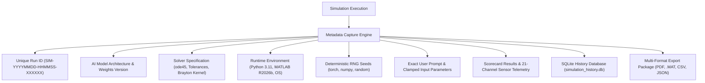

# JETWISE AI — Simulation Reproducibility & Provenance Standard Guide

**Document Reference:** `JETWISE-AI-GUIDE-PHASE17-REPRODUCIBILITY-01`  
**Classification:** Aerospace Simulation Provenance & Regulatory Compliance Standard  
**Date:** November 22, 2026  
**Auditor:** Principal Aerospace Software Reliability & MLOps Architect  
**Target Architecture:** SQLite `simulation_history.db` & Multi-Format Exporter  

---

## 1. Executive Reproducibility Mandate

In certified aerospace prognostics, a predictive maintenance forecast or physical simulation result cannot be accepted for fleet dispatch unless it is **100% reproducible**. An engineer inspecting an engine failure prediction six months after an alert must be able to recreate the exact analytical pipeline, telemetry inputs, solver settings, and AI weights.

JETWISE AI implements a strict provenance architecture that captures every simulation run, configuration flag, solver state, and environment variable into a deterministic SQLite registry.

---

## 2. Provenance Metadata Architecture

Every simulation executed in JETWISE AI automatically records a comprehensive reproducibility bundle:



### 2.1 Metadata Elements Logged per Run
- **`simulation_id`:** Globally unique, timestamp-anchored identifier (e.g. `SIM-20261122-143000-A1B2C3`).
- **`original_prompt`:** The raw natural-language query issued by the operator.
- **`scenario_name`:** Formal scenario classification.
- **`engine_id` & `dataset_id`:** Monitored unit number and fleet baseline dataset.
- **`simulation_mode`:** `MODE_A` (Sensor What-If), `MODE_B` (Dynamic Wear), or `MODE_C` (Physics).
- **`simulation_backend`:** Explicit solver origin (`MATLAB R2026b ODE Solver` or `NASA Brayton Cycle Fallback`).
- **`solver_parameters`:** Numerical integration method (`ode45 Dormand-Prince`) and relative tolerance ($10^{-4}$).
- **`random_seed`:** Deterministic RNG seed ($42$ by default) ensuring identical Monte Carlo dropout intervals.
- **`ai_model_name` & `version`:** Dual-branch CNN-LSTM-Pinball architecture version checkpoint.
- **`verification_checklist`:** Results of the 7 aerothermal conservation and monotonicity checks.

---

## 3. SQLite Database Schema (`simulation_history.db`)

Historical simulations are persisted in a local relational database supporting zero-data-loss schema migrations:

```sql
CREATE TABLE IF NOT EXISTS simulation_runs (
    simulation_id TEXT PRIMARY KEY,
    execution_timestamp TEXT NOT NULL,
    original_prompt TEXT,
    scenario_name TEXT NOT NULL,
    engine_id INTEGER NOT NULL,
    dataset_id TEXT NOT NULL,
    manufacturer TEXT DEFAULT 'NASA / Generic High-Bypass',
    engine_family TEXT DEFAULT 'Dual-Spool Turbofan',
    simulation_mode TEXT NOT NULL,
    simulation_backend TEXT NOT NULL,
    matlab_version TEXT,
    simulink_version TEXT,
    solver_name TEXT DEFAULT 'ode45 (Dormand-Prince)',
    solver_tolerance REAL DEFAULT 0.0001,
    python_version TEXT,
    ai_model_name TEXT,
    predicted_rul REAL,
    rul_delta REAL,
    uncertainty_sigma REAL,
    health_score REAL,
    risk_score REAL,
    anomaly_score REAL,
    validity_status TEXT,
    validity_details_json TEXT,
    structured_parameters_json TEXT,
    telemetry_summary_json TEXT,
    execution_status TEXT DEFAULT 'COMPLETED',
    warnings_json TEXT
);
```

---

## 4. Multi-Format Engineering Export Package

To support cross-disciplinary aerospace teams, every completed simulation can be exported in four standard industry formats via **Hub 4 (ANALYZE)**:

### 4.1 Professional Vector PDF Dossier (`.pdf`)
- Generated via Python `reportlab` engine without external rendering dependencies.
- Features standard aerospace documentation formatting, executive summary tables, 6-dimension scorecard matrices, 10-subassembly wear breakdown, and physical sign-off signature blocks.

### 4.2 MATLAB Binary Workspace (`.mat`)
- Serialized natively via `scipy.io.savemat` with binary compression.
- Allows flight dynamics teams to immediately load the entire simulated gas-path state directly into MathWorks MATLAB / Simulink without data translation:
  ```matlab
  load('JETWISE_Simulation_Export.mat');
  plot(telem_cycle, telem_sensor_4); % Plot EGT trajectory
  ```

### 4.3 High-Rate Telemetry Matrix (`.csv`)
- Full tabular flight cycle telemetry matrix recording all active sensor channels ($T_2, T_{24}, T_{30}, T_{50}, P_2, P_{15}, P_{30}, N_f, N_c, W_f, \dots$).
- Formatted for direct ingestion into Python pandas, R, or corporate Flight Data Monitoring (FDM) software.

### 4.4 Structured Engineering Audit Dossier (`.json`)
- Complete machine-readable JSON representation capturing simulation metadata, model hyperparameters, conformal confidence intervals, and scorecard breakdowns for automated MLOps pipelines.

---

## 5. Technical Validity Verification (7-Point Checklist)

Every simulation is automatically audited against 7 physical principles before being certified as valid:

1. **Input Boundary Validation:** Parameters verified within safe aerothermal operating envelopes.
2. **Model Linkage Check:** Engine profile verified against connected mathematical model.
3. **Mass Flow Continuity:** Mass flow rate delta across stations verified $\le 1.0\%$.
4. **Compression Monotonicity:** Total pressure must strictly rise ($P_2 < P_{24} < P_{30}$).
5. **Combustor Heat Addition:** Gas temperature must rise across combustor ($T_{30} < T_{48}$).
6. **Shaft Power Balance:** Turbine work extraction must balance compressor work demand.
7. **Prognostic Monotonicity:** Physical wear and cumulative damage must not spontaneously reverse without shop maintenance.
